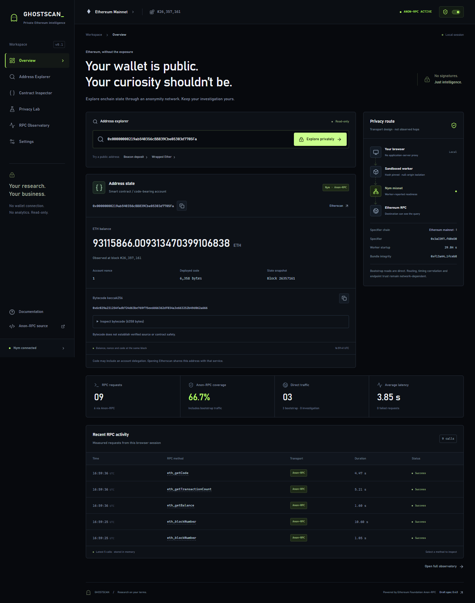
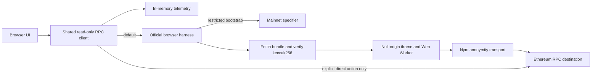

# GHOSTSCAN

**Your wallet is public. Your curiosity shouldn't be.**

A read-only Ethereum investigation terminal using the official Ethereum Foundation Anon-RPC browser harness. Nym is the default anonymity transport, verified with real Ethereum requests. No wallet connection, signatures, indexer, analytics or investigation backend.

This is a working MVP of an experimental, draft-standard integration. Successful worker responses are evidence of application integration, **not independent proof of network-layer anonymity**.

## Run locally

Requires Node.js 22.14+ and npm. No keys or environment file are required.

```sh
npm ci
npm run dev
```

Open [localhost:3000](http://127.0.0.1:3000). The default connection downloads the Nym bundle (approximately 18 MB). Allow time for startup; approximately 27–29 seconds was measured in the initial successful runs, but availability and latency vary.

For the static production export:

```sh
npm run build
npm start
```

Open [localhost:4173](http://127.0.0.1:4173). `npm start` serves `out/` with a local static server. It does not proxy or log investigations. Stop either server with Ctrl+C.

The homepage at `/` introduces the product without starting network connections. Enter the workspace at `/terminal`; section links support URL fragments such as `/terminal#privacy-lab`. No automatic address investigation runs on terminal load. Startup performs necessary direct bootstrap reads, then an anonymous chain-ID check and block read. Enter an address and press **Explore privately** to investigate.

## Implemented

- Address balances, nonce and deployed code at one common, explicitly observed block.
- Contract bytecode size and keccak256; detection of EIP-7702 delegation markers. No source-verification or safety inference.
- Nym default and explicitly selected Tor alternative using documented mainnet specifiers.
- Long-lived `AnonRpcWorker`, `ready`, `fetch`, `acceptLog` and `close` lifecycle.
- Privacy Lab runs an explicitly disclosed direct/anonymous balance comparison at the same block.
- Observatory with sanitized details, method/transport filters, memory-only history, accurate coverage and reduced-content JSON export.
- Explicit direct-mode confirmation; visible transport errors; reconnect; stale-response rejection.
- Responsive terminal UI and in-app documentation. External explorer links disclose the address to that service when clicked.



More screenshots: [Privacy Lab](docs/screenshots/privacy-lab.png), [mobile](docs/screenshots/explorer-mobile.png).

## Verified integration

Reviewed all six requested official resources before implementation; see [research record](docs/research.md).

| Setting | Value |
| --- | --- |
| Official package | `@anon-rpc/browser-harness@0.4.0` |
| Default network | Nym mixnet |
| Specifier chain | Ethereum mainnet, chain ID 1 |
| Specifier | `0x3aCD9742C68F6d993066Ae25533e09b9e1f60eD0` |
| Worker configuration | `undefined`, as documented |
| Observed worker hash | `0xf13a448a8721b9d0b20da3d5b80ffe00bf4c5bb3aae812a38d3d1e3bc81fceb8` |
| Initial RPC destination | `https://ethereum-rpc.publicnode.com` |

On **6 November 2026, 22:01:53 IST**, the real browser worker returned:

```text
eth_blockNumber → 0x1922d1f (26357023)
eth_getBalance(
  0x00000000219ab540356cBB839Cbe05303d7705Fa,
  0x1922d1f
) → 0x4d05f3d11457698c62cf16
    93115397.567313470399106838 ETH
```

These are dated test observations, not current balances. The initial test measured 694 ms for the block and 736 ms for the balance. The trace observed only a chain-ID check and two specifier calls as direct host JSON-RPC. No direct investigation RPC was observed. The worker logged `nym tunnel ready`; its opaque-origin IndexedDB shim reported ephemeral in-memory identity storage.

The subsequent production-browser test verified real Beacon deposit, WETH and no-code address reads, plus equal balances through direct and Nym paths. One comparison measured 291 ms direct and 1.19 s through Nym. Its export counted **20 requests: 16 Anon-RPC, 3 bootstrap, 1 explicit direct; 80% coverage**, with no failures in that window. See [test evidence](docs/verification/README.md).

**Tor did not pass the initial live test.** Its verified bundle started but could not download directory consensus/build circuits through the documented demonstration gateway, and the application timed out after 180 seconds. No direct investigation fallback occurred. It remains an explicitly selected experimental alternative; Nym does not automatically fall back to Tor either.

## Architecture



`src/lib/anon-rpc/client.ts` is the single dispatch boundary. The bootstrap provider checks mainnet once, then allows only `eth_call` with the exact `workerHash()` / `workerResolvers()` selector, selected specifier and `latest` tag. User address reads cannot pass its allowlist. The official harness verifies the resolver bytes and creates the sandbox. Readiness is accepted only after `worker.ready` **and** a mainnet chain-ID response through `worker.fetch`.

Anonymous requests fail closed. There is no catch-and-retry-direct path. Direct fetch is used for restricted bootstrap traffic, an explicitly confirmed direct session, or an intentionally started comparison. Reconnect closes the previous worker; generations reject stale completions. Input validation occurs before dispatch. Investigated addresses never appear in application URLs, application-server calls, localStorage or analytics.

`src/lib/ethereum/explorer.ts` validates addresses and obtains an observed block before reading all account fields at that block. `src/lib/telemetry.ts` redacts addresses and long hex values before storing events. Diagnostic export omits params, response content, endpoint URLs, raw error messages and worker logs. It still contains timestamps and methods; review before sharing.

## Privacy accounting and limits

Coverage is `Anon-RPC dispatched attempts / all application blockchain RPC dispatched attempts × 100`. Includes pending/failed attempts and every bootstrap call. It measures application dispatch, not confirmed network delivery. Clearing detailed history retains page-session totals, including bootstrap calls, so it cannot turn partial coverage into 100%. The export records how many detail rows were cleared. Reloading starts a new page session and bootstraps again. Retained events remain available to filters; the table displays the newest 100 matches, or 5 on Overview.

Page assets, bundle downloads, gateway connections and network-internal traffic are excluded because they are not application JSON-RPC calls. Their complete network behavior is not independently instrumented. The app never presents this coverage as an anonymity score.

See [threat model](docs/threat-model.md) for bootstrap trust, specifier governance, endpoint visibility, correlation and sandbox boundaries.

## Reproduce verification

With a local server running:

```sh
npm run typecheck
npm run lint
npm test
npm run build
npm start
```

In a second terminal, using installed Google Chrome:

```sh
# Defaults: Nym, dev server at port 3000, route /verify
npm run test:live

# Full real production UI flow, server at port 4173
npm run test:browser

# Inject a bootstrap HTTP 503, remove it, then reconnect to real Nym
npm run test:recovery
```

For production core verification on PowerShell:

```powershell
$env:TEST_URL = 'http://127.0.0.1:4173'
npm run test:live
# Optional: test the documented Tor alternative (initial test timed out)
$env:NETWORK = 'tor'
npm run test:live
```

Tests write actual results and screenshots to ignored `test-results/`. The live verifier fails if no real block/balance arrives or a host-direct investigation request is observed. Browser tests intentionally send public sample addresses directly only when exercising the comparison or confirmed direct mode. Unit tests use mocked dependencies for failure, lifecycle and policy checks; those mocks are **not** evidence of network integration. Chrome must be installed, or adapt the test runner to your installed Playwright browser.

## Configuration and deployment

Settings accepts HTTPS bootstrap/destination RPC URLs for the current page session. An RPC provider must support browser CORS for direct/bootstrap requests and allow the selected network's exits for anonymous requests. No server-held secrets exist. Avoid placing confidential credentials in browser configuration. The default specifiers/configurations come from the reviewed official adopter list; changes should be reviewed against upstream documentation.

`next build` exports browser-only assets to `out/`, suitable for Vercel or any HTTPS static host. No server routes, API proxy or server-side chain reads are needed. A production CSP must accommodate the official harness's sandbox/worker bootstrap and the network's WebAssembly and connections; a strict CSP added without testing can prevent readiness. See the [official browser harness CSP guidance](https://github.com/ethereum/anon-rpc/tree/main/impl/browser-harness#strict-content-security-policies). The local static server sets no-referrer and nosniff headers. TLS is required on a public host.

This checkout has no Git remote configured and has not been published. Add your repository remote before sharing or deploying the submission.

## Submission materials and next steps

- [Under-three-minute demo script](docs/demo-script.md)
- [Submission description](docs/submission.md)
- [Integration research](docs/research.md)
- [Threat model and known limitations](docs/threat-model.md)

Next: independent network instrumentation; ownership/update-policy verification of deployed specifiers; resilient operator-run gateways; worker lifecycle hardening upstream; optional token metadata via `eth_call`; accessible session export controls. ENS, arbitrary transaction history, pricing and security analysis are intentionally absent.

MIT licensed. See [LICENSE](LICENSE).

The decorative React Bits Faulty Terminal background is separately licensed under MIT + Commons Clause; see [its retained license and source notice](src/components/react-bits/README.md).
